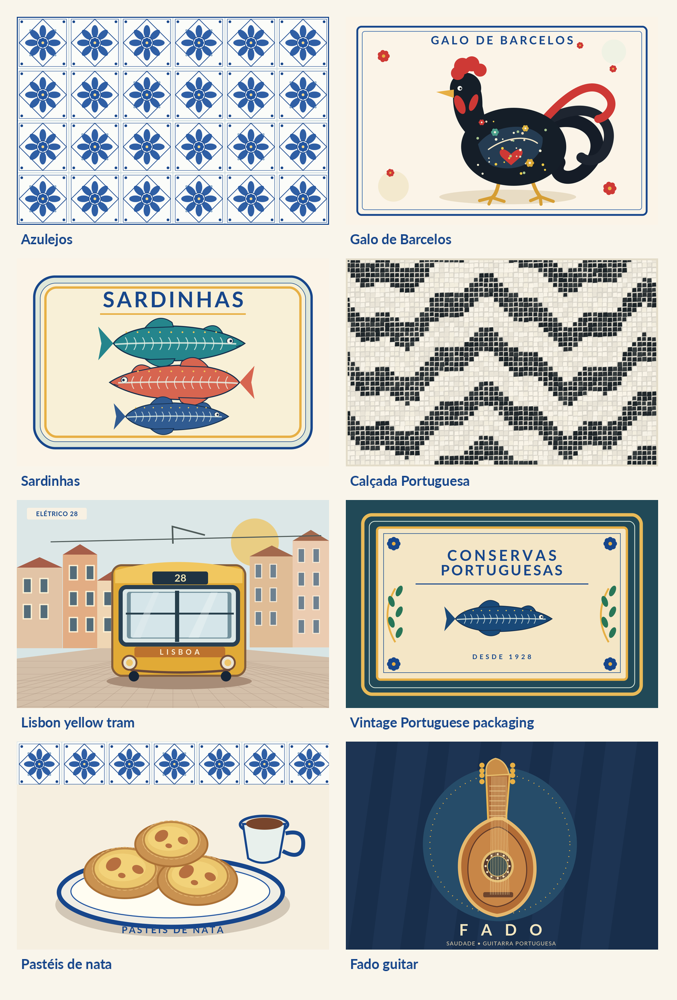
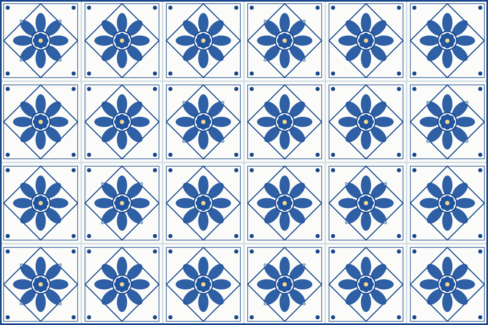
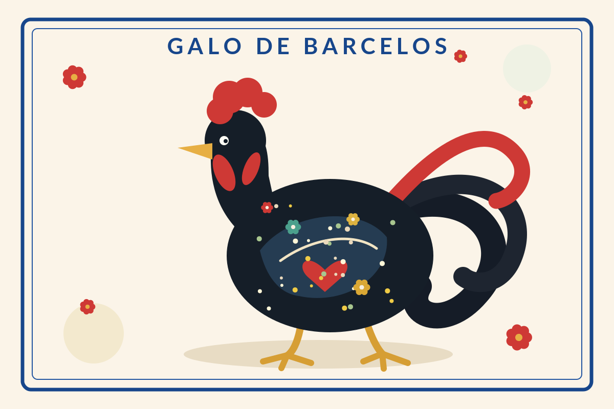
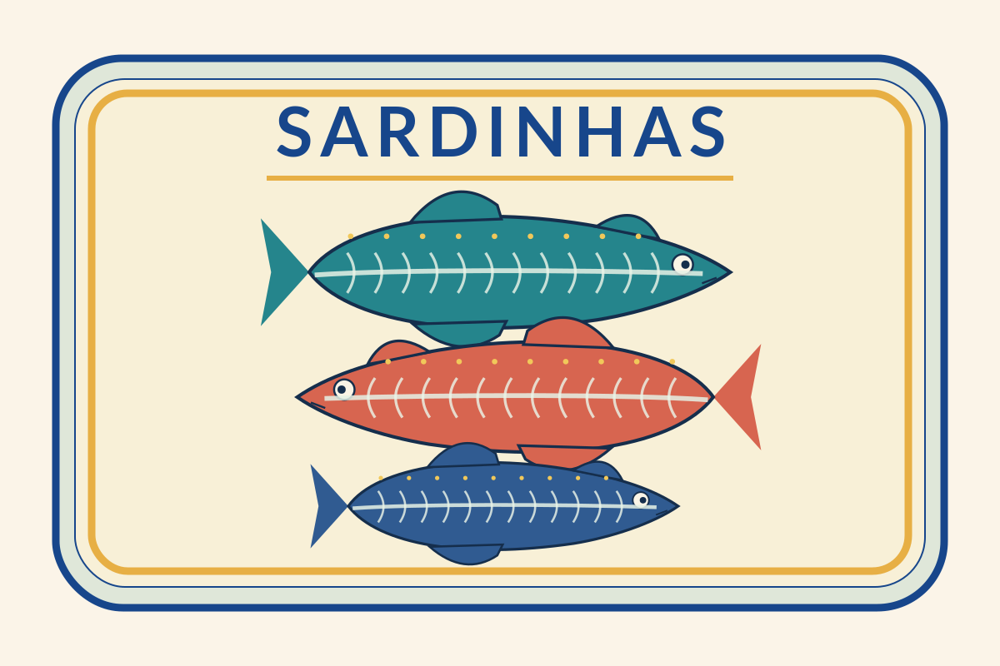
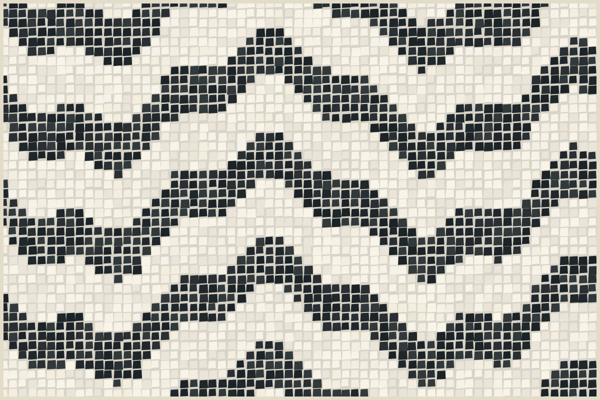
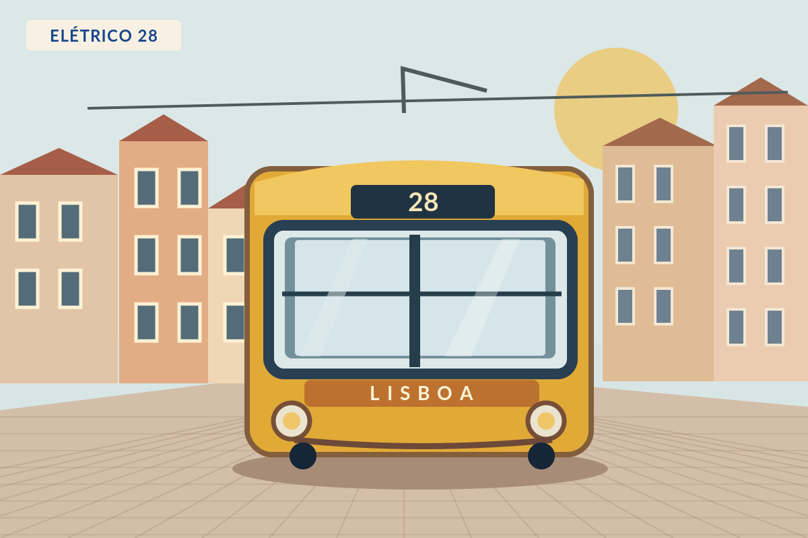
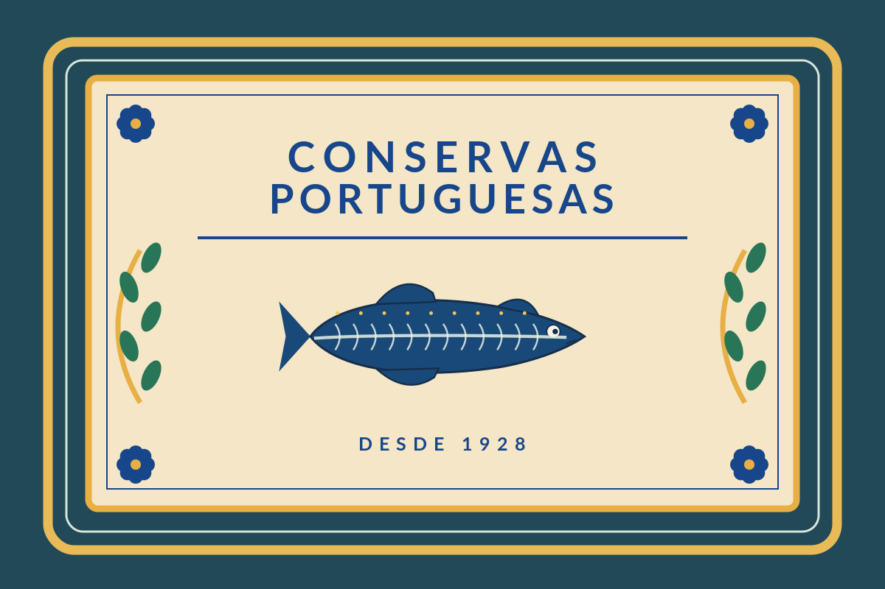
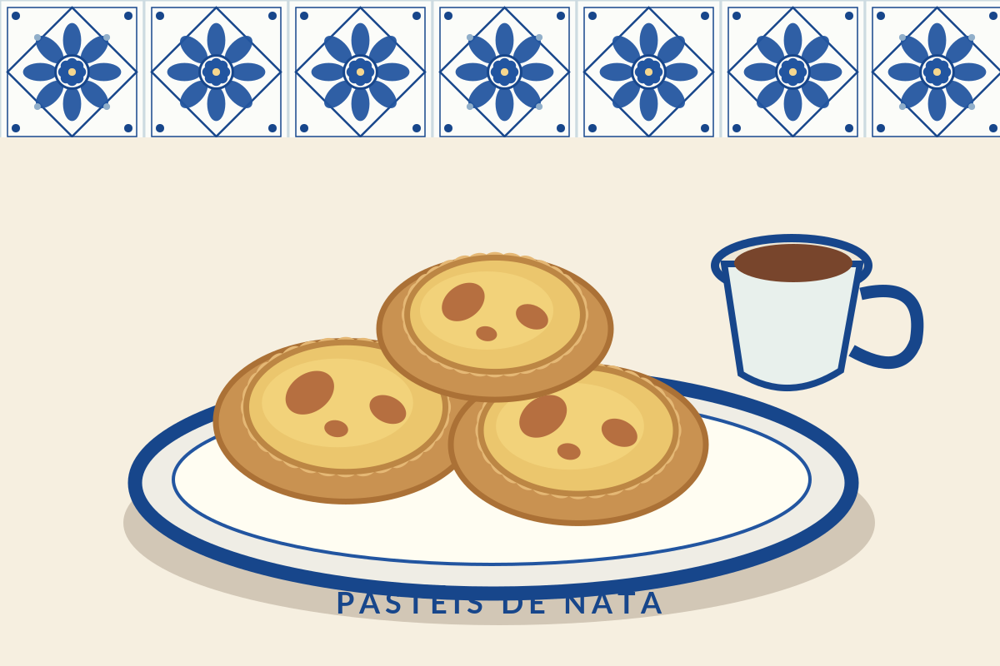
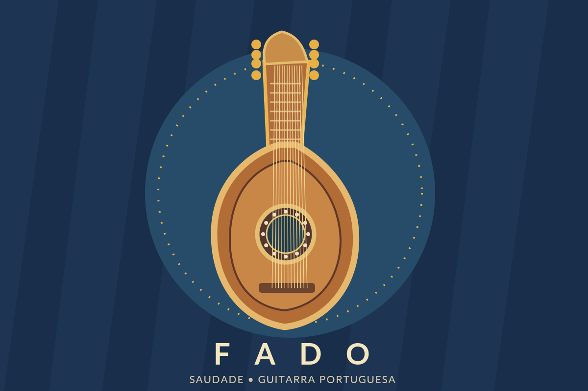

# Portugal-themed presentation – visual inspiration kit 🇵🇹

*A deliberately cliché Portuguese design direction: azulejos, roosters, sardines, Lisbon trams, vintage labels, pastéis de nata and Fado.*

**Everything shown here is stored locally.** You can browse this Markdown file offline. Each illustration is available as a ready-to-use **PNG** and a scalable **SVG** in `images/`.

## The iconic motifs

### 1. Azulejos — blue-and-white tiles

Decorative ceramic tile patterns with cobalt-blue geometry and floral ornament. Great for title slides, borders and chapter dividers. Use a small strip on content-heavy slides so it does not fight with the text.

**Slide idea:** Full-bleed tile background + large ivory text panel + blue title.

### 2. Galo de Barcelos — the rooster

Portugal's famous souvenir rooster: bold black silhouette, bright red comb, flowers and hearts. Use as a humorous mascot, oversized hero visual, or recurring marker on a few slides.

**Slide idea:** Large rooster on the right, headline on the left: *Bem-vindos a Portugal!*

### 3. Sardinhas — illustrated sardines

Playful, colorful fish illustrations reminiscent of Portuguese souvenir tins and festival graphics. Perfect for a tongue-in-cheek presentation.

**Slide idea:** Each section or numbered point features a different sardine.

### 4. Calçada Portuguesa — black-and-white paving

The instantly recognizable mosaic pavement of Portuguese streets, often with wavy black-and-white shapes. Useful for abstract backgrounds, narrow ribbons or a transition slide.

**Slide idea:** High-contrast mosaic at the bottom; leave the main text area plain.

### 5. Lisbon's yellow tram

The yellow *elétrico* 28, steep streets, colorful façades, overhead wiring and old-city charm.

**Slide idea:** Vintage travel-poster title slide featuring the tram.

### 6. Vintage Portuguese packaging

Ornate packaging, typographic emblems, decorative frames and heritage branding. Deep blue, gold and aged paper work especially well.

**Slide idea:** Turn your agenda into the front of a sardine tin or a nostalgic souvenir label.

### 7. Pastéis de nata

Golden custard tarts, coffee, ceramics and café imagery. A friendly recurring illustration for breaks or lighter moments.

**Slide idea:** A *coffee break* slide: *Pausa para um pastel de nata.*

### 8. Fado and the Portuguese guitar

For a moodier, more nostalgic or artistic approach: a Portuguese guitar, deep blue backdrop, gold embellishments and restrained serif typography.

**Slide idea:** A strong visual for storytelling or a closing slide.

## Three recommended looks

| Look | Best elements | Mood |
| --- | --- | --- |
| **Traditional azulejo** | `01_azulejos`, ivory backgrounds, blue text | Elegant and recognizably Portuguese |
| **Maximum souvenir kitsch** | `02_galo_de_barcelos`, `03_sardinhas`, `07_pasteis_de_nata` | Humorous, colorful and intentionally excessive |
| **Vintage Portuguese tourism** | `05_lisbon_tram`, `06_vintage_packaging`, `08_fado_guitar` | Retro, warm, nostalgic |

## Suggested color palette

| Color | Hex | Use |
| --- | --- | --- |
| Azulejo blue | `#17468B` | Headings, tiles, decorative framing |
| Ivory | `#FBF4E8` | Primary background |
| Rooster red | `#CE3935` | Accent or mascot details |
| Tram yellow | `#E8B843` | Bright secondary accent |
| Portuguese green | `#287557` | Secondary accent |
| Deep ink | `#152E4C` | Body copy and dark slides |

## Suggested six-slide outline

1. **Welcome:** Full azulejo background, huge Galo de Barcelos and *Bem-vindos a Portugal!*
2. **Agenda:** Vintage sardine-tin label with three or four content blocks.
3. **First content section:** Clean ivory slide, cobalt-blue headline and one tile border.
4. **Transition:** Giant yellow Lisbon tram, almost no text.
5. **Final content section:** Ivory background, small decorative rooster or sardine in a corner.
6. **Thank you:** *Obrigado!* with a colourful sardine or pastel de nata illustration.

## Reuse and image credits

All eight artwork files were **originally created for this kit** as stylized vector illustrations, not downloads of the exact reference photographs shown in the earlier conversation. They are visual interpretations of widely recognized Portuguese motifs. PNG versions are suitable for slide decks; SVG versions preserve scalability and are often editable in illustration software.

These illustrations can be reused and modified in your presentation. The names *Galo de Barcelos* and *Azulejos* describe traditional cultural symbols, not a claim of an official tourism brand or endorsement.

For real photographs, Wikimedia Commons has openly licensed examples. Check each individual image's attribution and share-alike requirements:

- [Azulejos – source photograph by Joseolgon (CC BY-SA 4.0)](https://commons.wikimedia.org/wiki/File:Azulejos_in_Capela_de_S%C3%A3o_Jos%C3%A9_Barcelos.jpg)
- [Galo de Barcelos tile – photograph by Eric Wüstenhagen (CC BY-SA 2.0)](https://commons.wikimedia.org/wiki/File:Der_Hahn_von_Barcelos.jpg)
- [Calçada Portuguesa – photograph by Yelkrokoyade (CC BY-SA 3.0)](https://commons.wikimedia.org/wiki/File:Cal%C3%A7ada_portuguesa_1.jpg)
